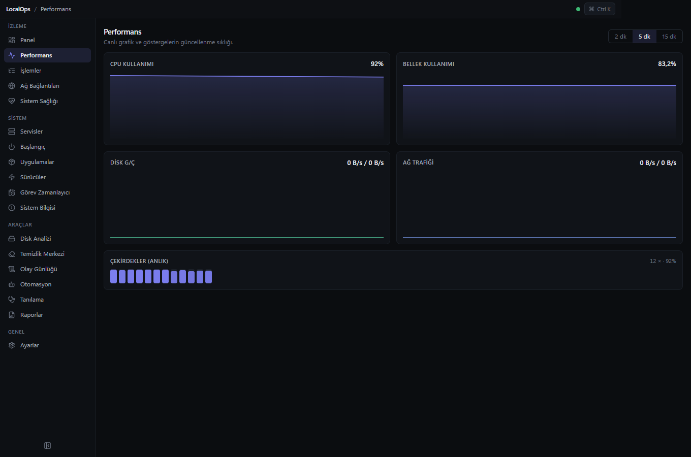
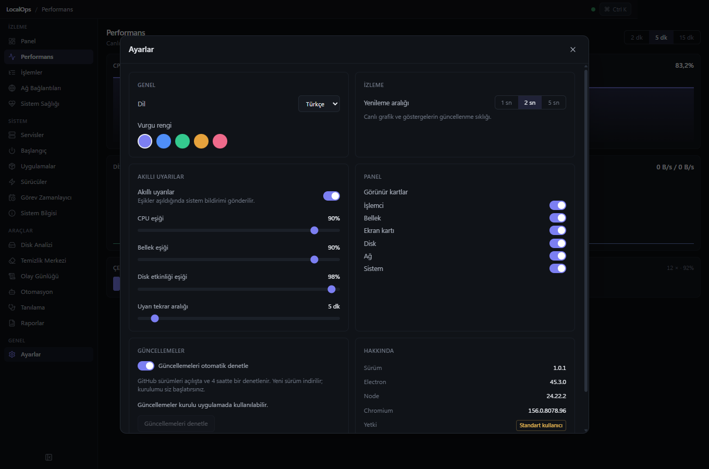

# LocalOps

**Your Windows. Fully Under Control.**

Windows 10 / 11 için modern, gerçek sistem verileriyle çalışan sistem yönetim uygulaması.
Görev Yöneticisi, Process Explorer, Resource Monitor ve gelişmiş sistem araçlarını tek bir hızlı arayüzde birleştirir.

[Windows için indir](https://github.com/Taxperia/LocalOps/releases/latest) · [Katkıda bulun](CONTRIBUTING.md) · [Güvenlik](SECURITY.md) · [Davranış kuralları](CODE_OF_CONDUCT.md)

## Ekran görüntüleri

Gerçek sistem verileriyle performans izleme:



<details>
<summary>Ayarlar penceresini görüntüle</summary>



</details>

## Teknolojiler

Electron · React 19 · TypeScript (strict) · Vite (electron-vite) · Tailwind CSS 4 · Zustand · Recharts · Lucide Icons

Sistem verileri Node.js `os` modülü ve Windows PowerShell/CIM (WMI) üzerinden toplanır — hiçbir veri uydurulmaz, desteklenmeyen sensörler "desteklenmiyor" olarak gösterilir.

## Geliştirme

Node.js 22.12+ (önerilen: Node.js 24) ve Windows 10/11 x64 gerekir.

```bash
npm ci
npm run dev      # geliştirme (HMR)
```

## Diğer komutlar

```bash
npm run typecheck   # TypeScript strict tip kontrolü
npm test            # vitest birim testleri
npm run build       # üretim derlemesi (out/)
npm run preview     # derlenen uygulamayı çalıştır
npm run test:e2e    # derlenmiş uygulamada Electron arayüz testleri
npm run dist        # Windows NSIS kurulum paketi ve güncelleme dosyaları
```

## İndirme ve güncelleme

[GitHub Releases](https://github.com/Taxperia/LocalOps/releases/latest) üzerinden Windows kurulum dosyasını indirin.

Ayarlar penceresi mevcut sayfanın üzerinde modal olarak açılır. Güncellemeler bölümünde otomatik denetimi açıp kapatabilir, elle denetleyebilir ve indirilmiş sürümü kurabilirsiniz. Kurulu uygulama açılıştan 30 saniye sonra ve dört saatte bir sabit `Taxperia/LocalOps` GitHub deposunu denetler. Kararlı yeni sürümler otomatik indirilir, kurulum kullanıcı tarafından başlatılır. GitHub anahtarı uygulamaya dahil edilmez. Sistem metrikleri yerelde tutulur; güncelleme denetimi ve indirmesi GitHub'a ağ istekleri gönderir.

Eski 0.x sürümlerinde güncelleyici yoktur; 1.0.0'a ilk geçiş kurulum dosyasıyla yapılır.

## Sürüm yayınlama

`package.json` ve `package-lock.json` sürümlerini birlikte güncelleyin, gerekiyorsa `docs/releases/<sürüm>.md` ekleyin. Değişiklikleri ve eşleşen `v<sürüm>` Git etiketini GitHub'a gönderin. GitHub Actions tip kontrolünü, birim/arayüz testlerini ve bağımlılık taramasını çalıştırır; Windows kurulumunu üretir ve `.exe`, `.blockmap`, `latest.yml`, `SHA256SUMS.txt` dosyalarıyla release yayınlar. Çalışma akışındaki `GITHUB_TOKEN` GitHub tarafından sağlanır.

## Güvenlik ve doğrulama kapsamı

Renderer sandbox, context isolation ve kapalı Node integration kullanır. IPC yalnızca ana pencerenin ana çerçevesindeki uygulama belgesinden kabul edilir. Yeni pencereler, uygulama dışına gezinme ve tarayıcı izinleri engellenir. PowerShell metin girdileri tek tırnak kaçırtmasıyla işlenir ve PowerShell sabit Windows sistem yolundan çağrılır. Yayın sırasında `npm audit --audit-level=moderate` kontrolü zorunludur.

Bu sürümde Windows kod imza sertifikası yapılandırılmamıştır. Kurulum Windows tarafından doğrulanmış bir yayıncı adı göstermez. Güncelleme dosyalarının SHA512 özeti doğrulanır; Authenticode yayıncı doğrulaması için bir kod imza sertifikası gerekir. GitHub hesabının ve release yayınlama erişiminin korunması güncelleme güvenliğinin bir parçasıdır.

Otomatik arayüz testleri ayrı geçici ayarlarla gerçek sistemden veri okur; işlem listesi, detay paneli, modal, dil değişimi ve tüm sayfaların açılması denetlenir. Gerçek işlemleri sonlandırma, servis/güç/başlangıç ayarlarını değiştirme, uygulama kaldırma ve gerçek dosyaları silme bu testlerde çalıştırılmaz. Kaynak ve bağımlılık incelemesi, kapsamlı bağımsız bir sızma testi veya tüm ortamlarda güvenlik garantisi değildir.

## Durum

Modül bazlı ilerleme için [docs/PROGRESS.md](docs/PROGRESS.md) dosyasına bakın.

## Katkı ve topluluk

Hata bildirimi, geliştirme ortamı ve pull request süreci için [katkı rehberini](CONTRIBUTING.md) okuyun. Projeye katılım [davranış kurallarına](CODE_OF_CONDUCT.md) tabidir.

Güvenlik açıklarını [güvenlik politikasındaki](SECURITY.md) özel bildirim kanalı üzerinden paylaşın.

## Lisans

LocalOps, [MIT lisansı](LICENSE) ile sunulur.
